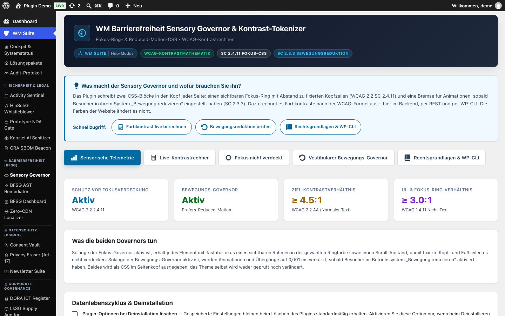
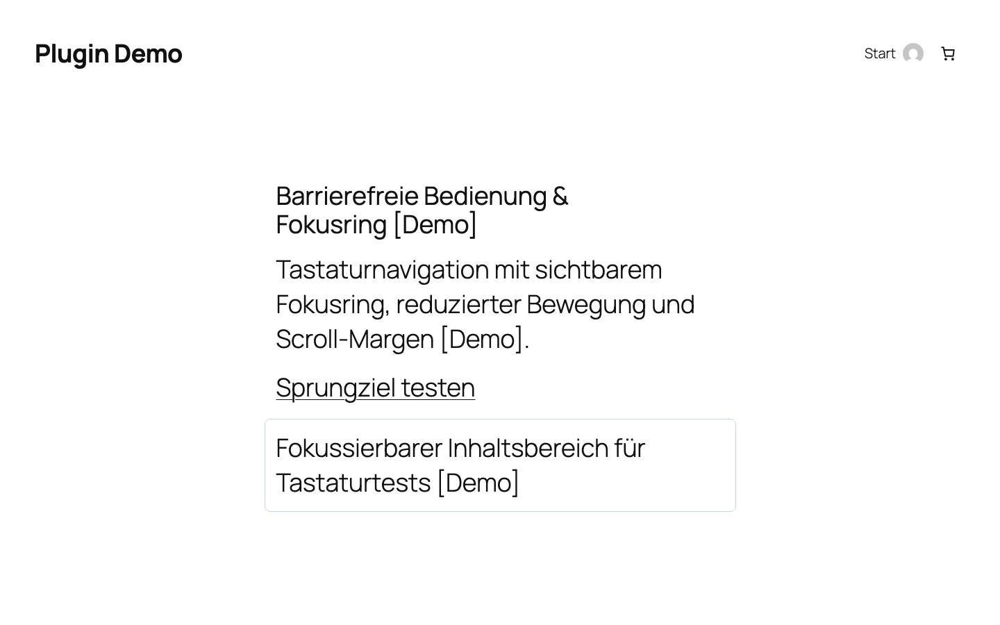
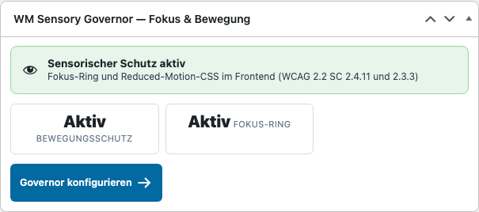

# WM A11y Sensory Governor (Deutsche Dokumentation)

<p align="center">
  <a href="README.md"></a>
  <a href="README.de.md"></a>
  <a href="README.es.md"></a>
</p>

> **Fokus-Ring- und Reduced-Motion-CSS nach WCAG 2.2 (SC 2.4.11 Focus Not Obscured, SC 2.3.3) im Kopf jeder Seite, dazu ein Farbkontrast-Rechner im Backend, per REST und auf der Kommandozeile**  
> **Plugin-Seite:** [https://arnoldwender.com/wordpress-plugins/wm-a11y-sensory-governor/](https://arnoldwender.com/wordpress-plugins/wm-a11y-sensory-governor/)  
> **Mit einem agentischen Workflow entwickelt:** entstanden mit KI-Coding-Agenten. Prüfen und testen Sie es wie jeden fremden Code, bevor Sie es produktiv einsetzen.  
> **Support & Haftung:** Kein Support (Zero Support) — reproduzierbare Bugs ausschließlich über [GitHub Issues](https://github.com/arnoldwender/wm-wp-a11y-sensory-governor/issues) · kein privater Support · OHNE GEWÄHR („AS IS“) / keine Haftung ([SUPPORT.md](SUPPORT.md))

> **Funktionsumfang:** Diese Dokumentation beschreibt ausschließlich das, was das Repository ausliefert: CSS-Regeln über `wp_head`, den WCAG-2.2-Kontrastrechner (Backend-Tab, ratenbegrenzte REST-Route `wm-sensory/v1/calculate-contrast` und `wp a11y contrast`), WordPress 6.5+ Block Bindings (`wm-sensory/tokens`), das GenerateBlocks-2.x-Dynamic-Tag (`{{wm_sensory_token}}`), vier Entwickler-Hooks, die WM-Suite-Hub-Integration sowie vier WordPress-Optionen mit Opt-in-Bereinigung bei der Deinstallation.

---

## Screenshots

!WM A11y Sensory Governor Banner

| Screenshot | Beschreibung |
| --- | --- |
|  | Administrationsbereich für Tastatur-Fokusring, Scroll-Margen, reduzierte Bewegung und WCAG-Kontrastrechner |
|  | Frontend-Sprungziel mit aktiven WM Sensory Governor Stylesheet-Tokens |
|  | WordPress-Dashboard-Widget mit aktivem Konfigurationsstatus und Direktlink |

---

## Was das Plugin leistet

1. **Fokus-Ring und Focus Not Obscured:** Bei aktivem *Fokus-Governor* (Standard) schreibt `wp_head` (Priorität 999) einen Block `<style id="wm-sensory-governor-tokens">`: jedes Element mit `:focus-visible` erhält `scroll-margin-top: 96px` und `scroll-margin-bottom: 48px`, damit fixierte Kopf- und Fußzeilen bis zu dieser Höhe es nicht verdecken (WCAG 2.2 SC 2.4.11), einen 3 px breiten Rahmen in der konfigurierten Ringfarbe mit 2 px Abstand und einen weichen Schatten in derselben Farbe — `includes/Governor/FocusObscuredGovernor.php`.
2. **Reduced-Motion-CSS:** Bei aktivem *Bewegungs-Governor* (Standard) begrenzt derselbe Block unter `prefers-reduced-motion: reduce` jede `animation-duration` und `transition-duration` auf 0,001 ms, setzt eine einzige Animationswiederholung und `scroll-behavior: auto` und entfernt Animation und Transformation von `.wm-parallax`, `.hero-animation`, `.marquee-track` und `.splide__track` (SC 2.3.3) — `includes/Governor/VestibularMotionGovernor.php`.
3. **Kontrast-Rechner:** `includes/Calculator/ContrastCalculator.php` setzt die WCAG-Formel der relativen Leuchtdichte um und liefert das Verhältnis mit den Urteilen AA / AAA / UI-Komponenten (SC 1.4.3, 1.4.11). Drei Zugänge: der Tab *Live Contrast Calculator* im Backend, `POST /wp-json/wm-sensory/v1/calculate-contrast` (ratenbegrenzt per `hash_hmac`-SHA-256-Transient-Bucket, JSON `foreground` / `background`) und `wp a11y contrast <vordergrund> <hintergrund>`.
4. **Backend & Opt-in-Deinstallation:** Menü *Sensory Governor* (Position 83; *WM Suite › Sensory Governor* mit aktivem WM Suite Hub), Seite `wm-sensory-governor` mit fünf Tabs: Sensory Telemetry (inklusive Opt-in-Einstellung zur Datenlöschung bei Deinstallation), Live Contrast Calculator, Focus Not Obscured (Schalter und Ringfarbe), Vestibular Motion Governor (Schalter), Law & WP-CLI. Gespeichert wird per nonce-geprüftem POST auf `admin_init` (`manage_options`). Ein Dashboard-Widget zeigt den Zustand der beiden Governors.
5. **Block Bindings, GenerateBlocks & WM Suite Hub:** `includes/Integrations/EcosystemBridge.php` registriert die Block-Bindings-Quelle `wm-sensory/tokens` und das GenerateBlocks-Dynamic-Tag `{{wm_sensory_token}}`. `includes/Adapters/Sensory_Spoke_Adapter.php` meldet sich über `wm_register_suite_module` mit SBOM, Telemetrie und den Aktionen `self_test` / `calculate_contrast`.

### Nicht enthalten

Kein Frontend-JavaScript, kein schwebendes Bedienfeld, kein Leselineal, kein Schriftwechsler; keine Cookies, kein localStorage; keine Shortcodes; keine eigenen Datenbanktabellen; kein Audit-Protokoll oder Export; keine externen Anfragen. Das Plugin speichert vier Optionen, die bei der Deinstallation standardmäßig erhalten bleiben, sofern die Löschung nicht ausdrücklich aktiviert wurde.

---

## Schnellstart

1. Plugin installieren und aktivieren (WordPress 6.4+, PHP 8.2+). Beide Governors sind standardmäßig aktiv: der CSS-Block steht ab dem ersten Seitenaufruf im Kopf der Website.
2. **Sensory Governor** im Admin-Menü öffnen (**WM Suite › Sensory Governor** mit Hub).
3. Tab *Focus Not Obscured*: Fokus-Governor schalten, Ringfarbe wählen und speichern. Tab *Vestibular Motion Governor*: Bewegungs-Governor schalten und speichern. Jedes Formular speichert nur seine eigenen Einstellungen.
4. Ein Farbpaar im Tab *Live Contrast Calculator* prüfen oder `wp a11y contrast #ffffff #050811` ausführen.

Optionen, Hooks, Klassen und bekannte Grenzen: **[README.md](README.md)** (Referenz) und **[DEVELOPERS.md](DEVELOPERS.md)**.

```bash
php tests/test-suite.php        # Standalone-Prüfungen, ohne WordPress
```

---

## Konformität

- **Keine externen Anfragen:** kein CDN, keine externen Schriften, keine externe Telemetrie; der einzige Netzwerkaufruf ist die eigene REST-Route der Website, wenn der Rechner-Tab benutzt wird.
- **Barrierefreiheit:** sichtbarer Fokus-Ring mit festen Scroll-Abständen (ausgerichtet auf WCAG 2.2 SC 2.4.7 / 2.4.11) und gestoppte CSS-Animationen und Übergänge für Besucher, die Bewegungsreduktion eingestellt haben (SC 2.3.3), auf jeder Seite mit `wp_head`, solange die Governors aktiv sind; nichts prüft an der gerenderten Seite, ob der Fokus tatsächlich sichtbar und unverdeckt ist; Kontraste nach der WCAG-Formel (SC 1.4.3 / 1.4.11). Das Plugin prüft oder ändert die Farben der Website nicht; es rechnet die Paare, die man ihm gibt.
- **Datenschutz:** es werden keine Klartext-IP-Adressen gespeichert; das REST-Ratenlimit speichert ausschließlich gesalzene HMAC-SHA256-Prüfsummen als kurzlebige Transients, dazu kommen die vier Plugin-Optionen.

---

## Lizenz

Vertrieben unter der **GNU General Public License v2 oder neuer** (`GPL-2.0-or-later`).  
Copyright (C) 2026 Arnold Wender.  
