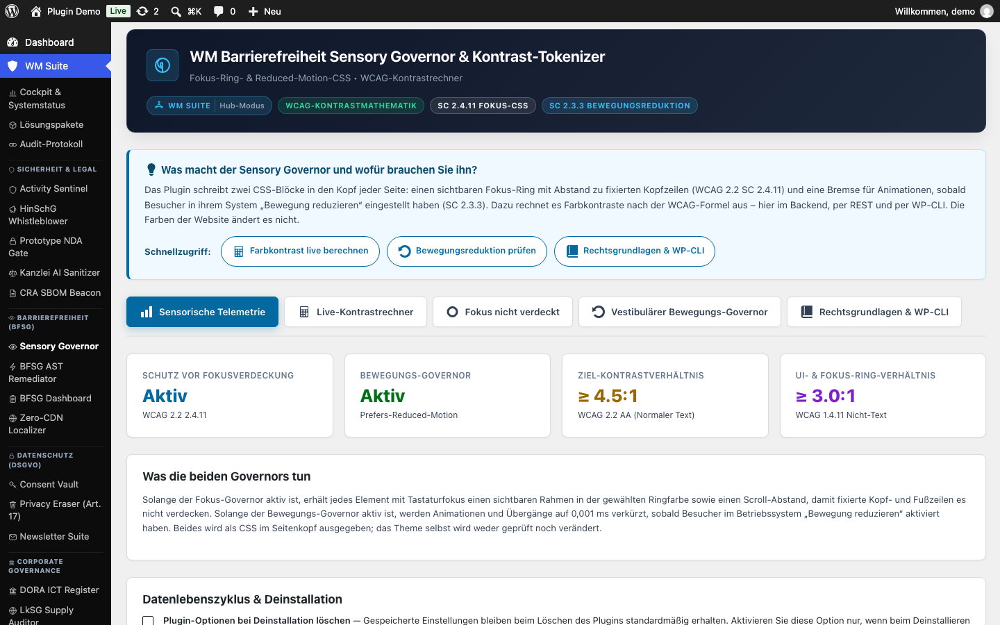
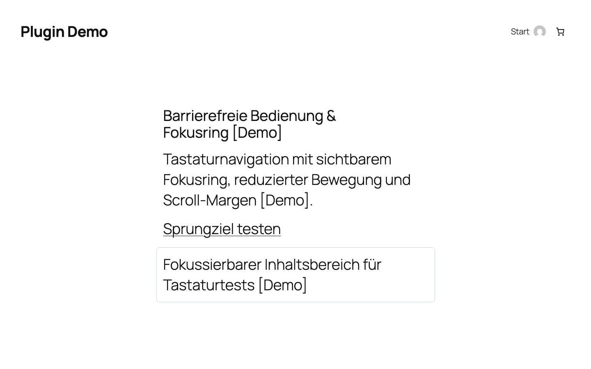
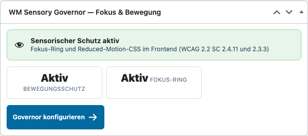

# WM A11y Sensory Governor (Documentación en Español)

<p align="center">
  <a href="README.md"></a>
  <a href="README.de.md"></a>
  <a href="README.es.md"></a>
</p>

> **CSS de anillo de foco y de movimiento reducido según WCAG 2.2 (SC 2.4.11 Focus Not Obscured, SC 2.3.3) impreso en el `<head>` del sitio, más una calculadora de contraste de color en el panel, por REST y en la línea de comandos**  
> **Página del Plugin:** [https://arnoldwender.com/es/plugins-wordpress/wm-a11y-sensory-governor/](https://arnoldwender.com/es/plugins-wordpress/wm-a11y-sensory-governor/)  
> **Desarrollado con un agentic workflow:** creado con agentes de programación de IA. Revísalo y pruébalo como cualquier código de terceros antes de usarlo en producción.  
> **Soporte y responsabilidad:** Cero soporte (Zero Support) — errores reproducibles únicamente en [GitHub Issues](https://github.com/arnoldwender/wm-wp-a11y-sensory-governor/issues) · sin soporte privado · TAL CUAL («AS IS») / sin responsabilidad ([SUPPORT.md](SUPPORT.md))

> **Alcance:** Este documento describe únicamente lo que el repositorio entrega: CSS en `wp_head`, calculadora de contraste WCAG 2.2 (pestaña de administración, ruta REST `wm-sensory/v1/calculate-contrast` con límite de tasa y comando `wp a11y contrast`), Block Bindings de WordPress 6.5+ (`wm-sensory/tokens`), etiqueta dinámica de GenerateBlocks 2.x (`{{wm_sensory_token}}`), cuatro hooks para desarrolladores, integración con WM Suite Hub y cuatro opciones de WordPress con limpieza opcional al desinstalar.

---

## Capturas de pantalla

!Banner de WM A11y Sensory Governor

| Captura | Descripción |
| --- | --- |
|  | Panel de administración para anillo de foco por teclado, márgenes de desplazamiento, movimiento reducido y calculadora WCAG |
|  | Objetivo accesible en el frontend con los tokens CSS activos de WM Sensory Governor |
|  | Widget del escritorio de WordPress con estado de configuración y enlace rápido |

---

## Qué hace el plugin

1. **Anillo de foco y Focus Not Obscured:** con el *governor de foco* activo (por defecto), `wp_head` (prioridad 999) imprime un bloque `<style id="wm-sensory-governor-tokens">`: cada elemento con `:focus-visible` recibe `scroll-margin-top: 96px` y `scroll-margin-bottom: 48px` para que las cabeceras y pies fijos hasta esa altura no lo tapen (WCAG 2.2 SC 2.4.11), un contorno de 3 px en el color de anillo configurado con 2 px de separación y una sombra suave del mismo color — `includes/Governor/FocusObscuredGovernor.php`.
2. **CSS de movimiento reducido:** con el *governor de movimiento* activo (por defecto), el mismo bloque limita bajo `prefers-reduced-motion: reduce` cada `animation-duration` y `transition-duration` a 0.001 ms, fija una sola iteración y `scroll-behavior: auto`, y retira animación y transformación de `.wm-parallax`, `.hero-animation`, `.marquee-track` y `.splide__track` (SC 2.3.3) — `includes/Governor/VestibularMotionGovernor.php`.
3. **Calculadora de contraste:** `includes/Calculator/ContrastCalculator.php` implementa la fórmula de luminancia relativa de WCAG y devuelve la relación con los veredictos AA / AAA / componentes de interfaz (SC 1.4.3, 1.4.11). Tres entradas: la pestaña *Live Contrast Calculator* del panel, `POST /wp-json/wm-sensory/v1/calculate-contrast` (con límite de peticiones mediante `hash_hmac` SHA-256 en transitorios, JSON `foreground` / `background`) y `wp a11y contrast <primer-plano> <fondo>`.
4. **Administración y desinstalación opcional:** menú *Sensory Governor* (posición 83; *WM Suite › Sensory Governor* con el WM Suite Hub activo), página `wm-sensory-governor` con cinco pestañas: Sensory Telemetry (incluida la opción de borrado al desinstalar), Live Contrast Calculator, Focus Not Obscured (interruptor y color del anillo), Vestibular Motion Governor (interruptor), Law & WP-CLI. Se guarda por POST con nonce en `admin_init` (`manage_options`). Un widget del escritorio muestra el estado de los dos governors.
5. **Block Bindings, GenerateBlocks y WM Suite Hub:** `includes/Integrations/EcosystemBridge.php` registra la fuente de Block Bindings `wm-sensory/tokens` y la etiqueta dinámica `{{wm_sensory_token}}` para GenerateBlocks 2.x. `includes/Adapters/Sensory_Spoke_Adapter.php` se registra por `wm_register_suite_module` con entrada SBOM, telemetría y las acciones `self_test` / `calculate_contrast`.

### No incluido

Sin JavaScript de frontend, sin controlador flotante, sin regla de lectura ni cambio de fuente; sin cookies ni localStorage; sin shortcodes; sin tablas propias; sin registro de auditoría ni exportaciones; sin peticiones externas. El plugin guarda cuatro opciones, que se conservan por defecto al desinstalar salvo que el administrador active expresamente su eliminación.

---

## Inicio rápido

1. Instala y activa el plugin (WordPress 6.4+, PHP 8.2+). Los dos governors vienen activos: el bloque CSS está en el `<head>` desde la primera carga.
2. Abre **Sensory Governor** en el menú de administración (**WM Suite › Sensory Governor** con el hub).
3. Pestaña *Focus Not Obscured*: activa o desactiva el governor de foco, elige el color del anillo y guarda. Pestaña *Vestibular Motion Governor*: activa o desactiva el de movimiento y guarda. Cada formulario guarda solo sus propios ajustes.
4. Comprueba un par de colores en la pestaña *Live Contrast Calculator* o ejecuta `wp a11y contrast #ffffff #050811`.

Opciones, hooks, clases y límites conocidos: **[README.md](README.md)** (referencia) y **[DEVELOPERS.md](DEVELOPERS.md)**.

```bash
php tests/test-suite.php        # comprobaciones standalone, sin WordPress
```

---

## Conformidad

- **Sin peticiones externas:** sin CDN, sin fuentes externas, sin telemetría externa; la única llamada de red es la ruta REST del propio sitio cuando se usa la pestaña de la calculadora.
- **Accesibilidad:** anillo de foco visible con márgenes de desplazamiento fijos (orientado a WCAG 2.2 SC 2.4.7 / 2.4.11) y animaciones y transiciones CSS detenidas para visitantes que piden movimiento reducido (SC 2.3.3), en cada página que llama a `wp_head` mientras los governors estén activos; nada comprueba en la página renderizada que el foco se vea y no quede tapado; contrastes con la fórmula WCAG (SC 1.4.3 / 1.4.11). El plugin no audita ni cambia los colores del sitio; calcula los pares que se le dan.
- **Privacidad:** no se almacenan direcciones IP en claro; el límite de tasa REST guarda únicamente resúmenes HMAC-SHA256 con sal en transitorios de 60 segundos, además de las cuatro opciones del plugin.

---

## Licencia

Distribuido bajo la **GNU General Public License v2 o posterior** (`GPL-2.0-or-later`).  
Copyright (C) 2026 Arnold Wender.  
