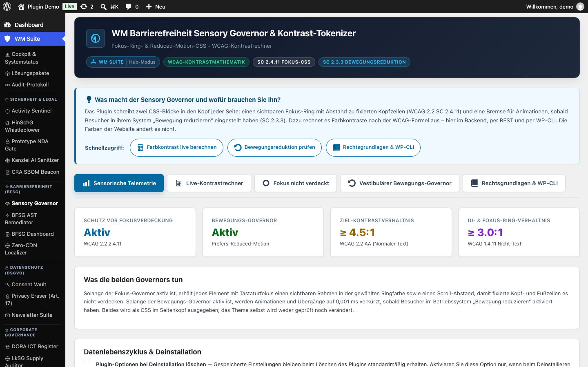
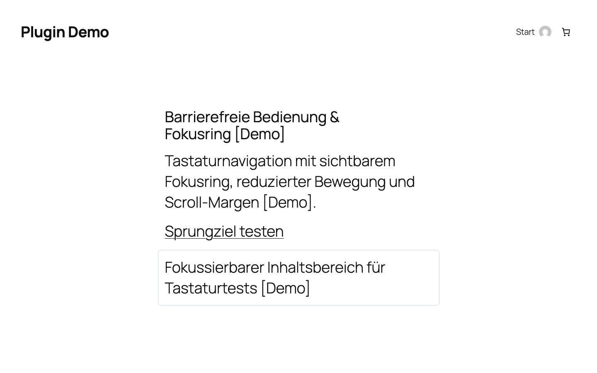
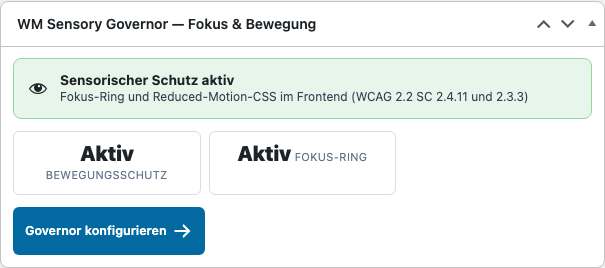

# WM A11y Sensory Governor

<p align="center">
  <a href="README.md"></a>
  <a href="README.de.md"></a>
  <a href="README.es.md"></a>
</p>

<p align="center">
  <a href="https://wordpress.org"></a>
  <a href="https://php.net"></a>
  
  <a href="https://www.gnu.org/licenses/gpl-2.0.html"></a>
</p>

> **Focus-ring and reduced-motion CSS for WCAG 2.2 (SC 2.4.11 Focus Not Obscured, SC 2.3.3) printed into the site head, plus a colour-contrast calculator in the admin, over REST and on the command line**  
> **Plugin Page:** [https://arnoldwender.com/wordpress-plugins/wm-a11y-sensory-governor/](https://arnoldwender.com/wordpress-plugins/wm-a11y-sensory-governor/)  
> **Built with an agentic workflow:** developed with AI coding agents. Review and test it like any third-party code before you use it in production.  
> **Support & Liability:** Zero support — reproducible bugs on [GitHub Issues](https://github.com/arnoldwender/wm-wp-a11y-sensory-governor/issues) only · no private support · AS IS / no liability ([SUPPORT.md](SUPPORT.md))

> **Scope:** This README documents only what the repository ships: CSS tokens on `wp_head`, a WCAG 2.2 relative-luminance contrast calculator (admin tab, rate-limited `POST wm-sensory/v1/calculate-contrast`, and `wp a11y contrast`), WordPress 6.5+ Block Bindings (`wm-sensory/tokens`), GenerateBlocks 2.x dynamic tag (`{{wm_sensory_token}}`), four developer hooks, WM Suite Hub spoke integration, and four WordPress options with opt-in uninstallation cleanup.

---

## Screenshots

!WM A11y Sensory Governor banner

| Screenshot | Description |
| --- | --- |
|  | Admin control screen for keyboard focus ring, scroll margins, motion reduction and exact WCAG contrast calculator |
|  | Frontend accessible skip target rendered alongside the active WM Sensory Governor stylesheet tokens |
|  | WordPress dashboard widget showing configured sensory protection status and quick link |

---

## What the plugin does

1. **Focus ring and Focus Not Obscured CSS.** With the *focus governor* on (default), `wp_head` (priority 999) prints a `<style id="wm-sensory-governor-tokens">` block: every `:focus-visible` element gets `scroll-margin-top: 96px` and `scroll-margin-bottom: 48px`, which keeps an element scrolled into view clear of a fixed header up to 96 px and a fixed footer up to 48 px (aimed at WCAG 2.2 SC 2.4.11; taller bars still cover it, and nothing measures the site's own bars), a 3 px outline in the configured ring colour with a 2 px offset, and a soft box-shadow in the same colour — `includes/Governor/FocusObscuredGovernor.php`.
2. **Reduced-motion CSS.** With the *motion governor* on (default), the same block clamps every `animation-duration` and `transition-duration` to 0.001 ms, sets one animation iteration and `scroll-behavior: auto` under `prefers-reduced-motion: reduce`, and removes animation and transform from `.wm-parallax`, `.hero-animation`, `.marquee-track` and `.splide__track` (aimed at WCAG 2.2 SC 2.3.3; motion driven by JavaScript is not affected) — `includes/Governor/VestibularMotionGovernor.php`.
3. **Contrast calculator.** `includes/Calculator/ContrastCalculator.php` implements the WCAG relative-luminance formula and returns the ratio with the AA / AAA / UI-component verdicts (SC 1.4.3, 1.4.11). Colours must be 3- or 6-digit hex codes (anything else is refused); verdicts use the exact ratio and the ratio shown is cut to two decimals, never rounded up. Three front doors: the *Live Contrast Calculator* tab of the admin screen, `POST /wp-json/wm-sensory/v1/calculate-contrast` (rate-limited via `check_public_contrast_access` using salted `hash_hmac` SHA-256 transient buckets, JSON `foreground` / `background`, stores no personal data) and `wp a11y contrast <foreground> <background>`.
4. **Admin & opt-in uninstall.** Menu *Sensory Governor* (position 83; *WM Suite › Sensory Governor* when the WM Suite Hub is active), page `wm-sensory-governor` with five tabs: Sensory Telemetry (including opt-in data lifecycle preference), Live Contrast Calculator, Focus Not Obscured (switch and ring colour), Vestibular Motion Governor (switch), Law & WP-CLI. Each settings form saves only its own fields through a nonce-checked POST on `admin_init` (`manage_options`). A dashboard widget shows the state of the two governors. Both render from the WM Suite admin family sheets.
5. **Block Bindings, GenerateBlocks & WM Suite Hub.** `includes/Integrations/EcosystemBridge.php` registers WordPress 6.5+ Block Bindings source `wm-sensory/tokens` and GenerateBlocks 2.x Dynamic Tag `{{wm_sensory_token}}` (`ring_color`, `ring_contrast`, `focus_status`, `motion_status`). `includes/Adapters/Sensory_Spoke_Adapter.php` registers through `wm_register_suite_module` with CycloneDX SBOM metadata, telemetry, and `self_test` / `calculate_contrast` actions.

### Not shipped

No frontend JavaScript, floating controller, reading ruler or font switcher; no cookies or localStorage; no shortcodes; no custom database tables; no audit log or export; no external requests. The plugin stores four options, preserved by default on uninstall unless `wm_sensory_delete_data_on_uninstall` is enabled.

---

## Quick start

1. Install and activate the plugin (WordPress 6.4+, PHP 8.2+). Both governors are on by default: the CSS block is in the site head from the first page load.
2. Open **Sensory Governor** in the admin menu (**WM Suite › Sensory Governor** with the WM Suite Hub).
3. *Focus Not Obscured* tab: switch the focus governor, pick the ring colour and save. *Vestibular Motion Governor* tab: switch the motion governor and save. *Sensory Telemetry* tab: optionally enable option cleanup on uninstall. Each form saves only its own fields.
4. Check a colour pair in the *Live Contrast Calculator* tab, or run `wp a11y contrast #ffffff #050811`.

### Options

| Option | Default | Written by |
| --- | --- | --- |
| `wm_sensory_focus_enabled` | `1` | Focus Not Obscured tab |
| `wm_sensory_motion_enabled` | `1` | Vestibular Motion Governor tab |
| `wm_sensory_ring_color` | `#06b6d4` | Focus Not Obscured tab (validated: six-digit hex or the default) |
| `wm_sensory_delete_data_on_uninstall` | `0` | Sensory Telemetry tab (opt-in deletion on uninstall) |

---

## Developers

Classes, hooks (`wm_sensory_ready`, `wm_sensory_tokens_css`, `wm_sensory_contrast_result`, `wm_sensory_rest_rate_limit`), Block Bindings, GenerateBlocks tag, the REST route, the WP-CLI command and the hub adapter: **[DEVELOPERS.md](DEVELOPERS.md)**.

```bash
php tests/test-suite.php         # standalone assertions, no WordPress needed
bash tests/run-mutations.sh      # each entry in tests/mutations.php undoes one fix; the suite must turn red
php tests/test-pot-freshness.php # every translatable string has a .pot entry (needs wp-cli; CI runs it on 8.3)
```

### Design notes & limitations

- The calculator tab keeps inline layout styles, an inline script and inline colours on the preview box (set from the two input values); the family sheets cover the page, not those controls. The colour pickers are 44 × 38 px.
- The REST route `wm-sensory/v1/calculate-contrast` enforces a per-minute transient rate limit (`wm_sensory_rl_*`, default 60 req/min, filterable via `wm_sensory_rest_rate_limit`) keyed by a salted `hash_hmac('sha256', ...)` digest so raw visitor IP addresses are never stored; administrators (`manage_options`) bypass the limit.
- `languages/` ships 28 compiled `.po`/`.mo` locale catalogs synchronized with `languages/wm-a11y-sensory-governor.pot` and guarded by `tests/test-pot-freshness.php`.
- The ring colour can be any six-digit hex colour; nothing checks its contrast against the site's own frontend backgrounds (the hub telemetry compares it against `#050811`).

---

## Translated documentation

Translated READMEs live in `docs/translations/README.<lang>.md`. Their headings are translated; the sections on what the plugin does, the quick start, what is not included and compliance are synchronized from this file by `wp-plugin-fleet-translations-sync.py`.

| Language (Native) | Locale Code | Language (Native) | Locale Code |
|---|---|---|---|
| [Български](docs/translations/README.bg.md) | `bg_BG` | [Magyar](docs/translations/README.hu.md) | `hu_HU` |
| [Čeština](docs/translations/README.cs.md) | `cs_CZ` | [Italiano](docs/translations/README.it.md) | `it_IT` |
| [Dansk](docs/translations/README.da.md) | `da_DK` | [Lietuvių](docs/translations/README.lt.md) | `lt_LT` |
| [Deutsch](README.de.md) | `de_DE` | [Latviešu](docs/translations/README.lv.md) | `lv_LV` |
| [Ελληνικά](docs/translations/README.el.md) | `el_GR` | [Malti](docs/translations/README.mt.md) | `mt_MT` |
| [English](README.md) | `en_GB` | [Nederlands](docs/translations/README.nl.md) | `nl_NL` |
| [Español](README.es.md) | `es_ES` | [Polski](docs/translations/README.pl.md) | `pl_PL` |
| [Eesti](docs/translations/README.et.md) | `et_EE` | [Português](docs/translations/README.pt.md) | `pt_PT` |
| [Suomi](docs/translations/README.fi.md) | `fi_FI` | [Română](docs/translations/README.ro.md) | `ro_RO` |
| [Français](docs/translations/README.fr.md) | `fr_FR` | [Slovenčina](docs/translations/README.sk.md) | `sk_SK` |
| [Gaeilge](docs/translations/README.ga.md) | `ga_IE` | [Slovenščina](docs/translations/README.sl.md) | `sl_SI` |
| [Hrvatski](docs/translations/README.hr.md) | `hr_HR` | [Svenska](docs/translations/README.sv.md) | `sv_SE` |

---

## Compliance

- **Zero external requests:** no CDN, no external fonts, no external telemetry; the only network call is the site's own REST route when the calculator tab is used.
- **Accessibility:** a visible focus ring with fixed scroll margins (aimed at WCAG 2.2 SC 2.4.7 / 2.4.11) and CSS animations and transitions stopped for visitors who ask for reduced motion (SC 2.3.3), on every page that calls `wp_head` while the governors are on; nothing renders the site to check that focus is actually visible and uncovered; contrast ratios computed with the WCAG formula (SC 1.4.3 / 1.4.11). The plugin does not audit or change the site's own colours; it computes ratios for the pairs it is given.
- **Privacy:** no raw IP address or personal profile is stored; public REST rate-limit buckets store only salted HMAC-SHA256 digests in 60-second transients, and configuration lives in four WordPress options.

---

## Contribution & Security

- [CONTRIBUTING.md](CONTRIBUTING.md) · [SECURITY.md](SECURITY.md) · [CHANGELOG.md](CHANGELOG.md)

---

## License

Distributed under the **GNU General Public License v2 or later** (`GPL-2.0-or-later`).  
Copyright (C) 2026 Arnold Wender.  
