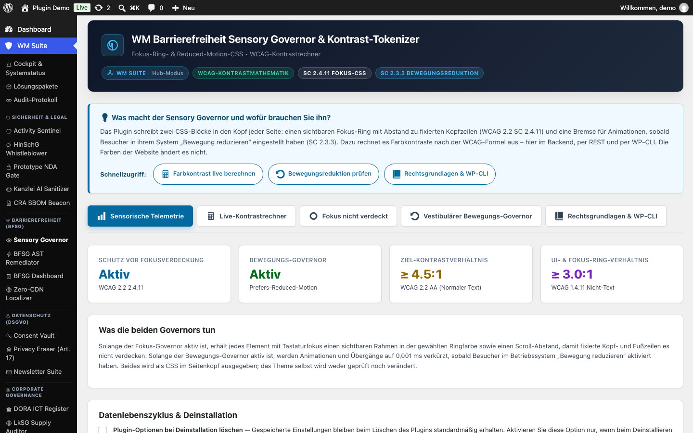

# WM A11y Sensory Governor (Deutsch)

  [🇧🇬 Български](README.bg.md) • [🇨🇿 Čeština](README.cs.md) • [🇩🇰 Dansk](README.da.md) • [🇩🇪 Deutsch](../../README.de.md) • [🇬🇷 Ελληνικά](README.el.md) • [🇬🇧 English](../../README.md) • [🇪🇸 Español](../../README.es.md) • [🇪🇪 Eesti](README.et.md) • [🇫🇮 Suomi](README.fi.md) • [🇫🇷 Français](README.fr.md) • [🇮🇪 Gaeilge](README.ga.md) • [🇭🇷 Hrvatski](README.hr.md) [🇭🇺 Magyar](README.hu.md) • [🇮🇹 Italiano](README.it.md) • [🇱🇹 Lietuvių](README.lt.md) • [🇱🇻 Latviešu](README.lv.md) • [🇲🇹 Malti](README.mt.md) • [🇳🇱 Nederlands](README.nl.md) • [🇵🇱 Polski](README.pl.md) • [🇵🇹 Português](README.pt.md) • [🇷🇴 Română](README.ro.md) • [🇸🇰 Slovenčina](README.sk.md) • [🇸🇮 Slovenščina](README.sl.md) • [🇸🇪 Svenska](README.sv.md)

---

  
  
  
  
  

> **Focus-ring and reduced-motion CSS for WCAG 2.2 (SC 2.4.11 Focus Not Obscured, SC 2.3.3) printed into the site head, plus a colour-contrast calculator in the admin, over REST and on the command line**  
> **Plugin-Seite:** [https://arnoldwender.com/wordpress-plugins/wm-a11y-sensory-governor/](https://arnoldwender.com/wordpress-plugins/wm-a11y-sensory-governor/)  
> **Mit einem agentischen Workflow entwickelt:** entstanden mit KI-Coding-Agenten. Prüfen und testen Sie es wie jeden fremden Code, bevor Sie es produktiv einsetzen.  
> **Support & Liability:** Zero support — reproducible bugs on [GitHub Issues](https://github.com/arnoldwender/wm-wp-a11y-sensory-governor/issues) only · no private support · AS IS / no liability ([SUPPORT.md](../../SUPPORT.md))

---

## 📸 Deutsch Enterprise Showcase

!WM A11y Sensory Governor Banner

---

## 🟢 STUFE 1: SCHNELLSTART-ANLEITUNG FÜR EINSTEIGER & WEBSITE-BETREIBER (NO-CODE)

### Was leistet dieses Plugin für Ihre Website?
Focus-ring and reduced-motion CSS for WCAG 2.2 (SC 2.4.11 Focus Not Obscured, SC 2.3.3) printed into the site head, plus a colour-contrast calculator in the admin, over REST and on the command line

### 🚀 In 2 Minuten startklar (Schritt-für-Schritt ohne Code):
1. Install and activate the plugin (WordPress 6.4+, PHP 8.2+). Both governors are on by default: the CSS block is in the site head from the first page load.
2. Open **Sensory Governor** in the admin menu (**WM Suite › Sensory Governor** with the WM Suite Hub).
3. *Focus Not Obscured* tab: switch the focus governor, pick the ring colour and save. *Vestibular Motion Governor* tab: switch the motion governor and save. *Sensory Telemetry* tab: optionally enable option cleanup on uninstall. Each form saves only its own fields.
4. Check a colour pair in the *Live Contrast Calculator* tab, or run `wp a11y contrast #ffffff #050811`.

### 💡 Häufig gestellte Fragen für Einsteiger:
#### ❓ What is not included?
No frontend JavaScript, floating controller, reading ruler or font switcher; no cookies or localStorage; no shortcodes; no custom database tables; no audit log or export; no external requests. The plugin stores four options, preserved by default on uninstall unless `wm_sensory_delete_data_on_uninstall` is enabled.

---

## 🟡 STUFE 2: WEBMASTER & ADMINISTRATOREN-HANDBUCH

### What the plugin does
1. **Focus ring and Focus Not Obscured CSS.** With the *focus governor* on (default), `wp_head` (priority 999) prints a `<style id="wm-sensory-governor-tokens">` block: every `:focus-visible` element gets `scroll-margin-top: 96px` and `scroll-margin-bottom: 48px`, which keeps an element scrolled into view clear of a fixed header up to 96 px and a fixed footer up to 48 px (aimed at WCAG 2.2 SC 2.4.11; taller bars still cover it, and nothing measures the site's own bars), a 3 px outline in the configured ring colour with a 2 px offset, and a soft box-shadow in the same colour — `includes/Governor/FocusObscuredGovernor.php`.
2. **Reduced-motion CSS.** With the *motion governor* on (default), the same block clamps every `animation-duration` and `transition-duration` to 0.001 ms, sets one animation iteration and `scroll-behavior: auto` under `prefers-reduced-motion: reduce`, and removes animation and transform from `.wm-parallax`, `.hero-animation`, `.marquee-track` and `.splide__track` (aimed at WCAG 2.2 SC 2.3.3; motion driven by JavaScript is not affected) — `includes/Governor/VestibularMotionGovernor.php`.
3. **Contrast calculator.** `includes/Calculator/ContrastCalculator.php` implements the WCAG relative-luminance formula and returns the ratio with the AA / AAA / UI-component verdicts (SC 1.4.3, 1.4.11). Colours must be 3- or 6-digit hex codes (anything else is refused); verdicts use the exact ratio and the ratio shown is cut to two decimals, never rounded up. Three front doors: the *Live Contrast Calculator* tab of the admin screen, `POST /wp-json/wm-sensory/v1/calculate-contrast` (rate-limited via `check_public_contrast_access` using salted `hash_hmac` SHA-256 transient buckets, JSON `foreground` / `background`, stores no personal data) and `wp a11y contrast <foreground> <background>`.
4. **Admin & opt-in uninstall.** Menu *Sensory Governor* (position 83; *WM Suite › Sensory Governor* when the WM Suite Hub is active), page `wm-sensory-governor` with five tabs: Sensory Telemetry (including opt-in data lifecycle preference), Live Contrast Calculator, Focus Not Obscured (switch and ring colour), Vestibular Motion Governor (switch), Law & WP-CLI. Each settings form saves only its own fields through a nonce-checked POST on `admin_init` (`manage_options`). A dashboard widget shows the state of the two governors. Both render from the WM Suite admin family sheets.
5. **Block Bindings, GenerateBlocks & WM Suite Hub.** `includes/Integrations/EcosystemBridge.php` registers WordPress 6.5+ Block Bindings source `wm-sensory/tokens` and GenerateBlocks 2.x Dynamic Tag `{{wm_sensory_token}}` (`ring_color`, `ring_contrast`, `focus_status`, `motion_status`). `includes/Adapters/Sensory_Spoke_Adapter.php` registers through `wm_register_suite_module` with CycloneDX SBOM metadata, telemetry, and `self_test` / `calculate_contrast` actions.

### Not shipped
No frontend JavaScript, floating controller, reading ruler or font switcher; no cookies or localStorage; no shortcodes; no custom database tables; no audit log or export; no external requests. The plugin stores four options, preserved by default on uninstall unless `wm_sensory_delete_data_on_uninstall` is enabled.

---

## 🔴 STUFE 3: ENTWICKLER & SOFTWARE-ARCHITEKTEN

Classes, hooks, options, the admin screen and the WM Suite Hub adapter are documented in the English manual: **[DEVELOPERS.md](../../DEVELOPERS.md)**.

---

## ⚖️ Gesetzliche Grundlagen & EU-Konformität

- **Zero external requests:** no CDN, no external fonts, no external telemetry; the only network call is the site's own REST route when the calculator tab is used.
- **Accessibility:** a visible focus ring with fixed scroll margins (aimed at WCAG 2.2 SC 2.4.7 / 2.4.11) and CSS animations and transitions stopped for visitors who ask for reduced motion (SC 2.3.3), on every page that calls `wp_head` while the governors are on; nothing renders the site to check that focus is actually visible and uncovered; contrast ratios computed with the WCAG formula (SC 1.4.3 / 1.4.11). The plugin does not audit or change the site's own colours; it computes ratios for the pairs it is given.
- **Privacy:** no raw IP address or personal profile is stored; public REST rate-limit buckets store only salted HMAC-SHA256 digests in 60-second transients, and configuration lives in four WordPress options.

---

## 🔒 Lizenz & Urheberrecht

Distributed under the **GNU General Public License v2 or later**.  
Copyright (C) 2026 Arnold Wender.  
